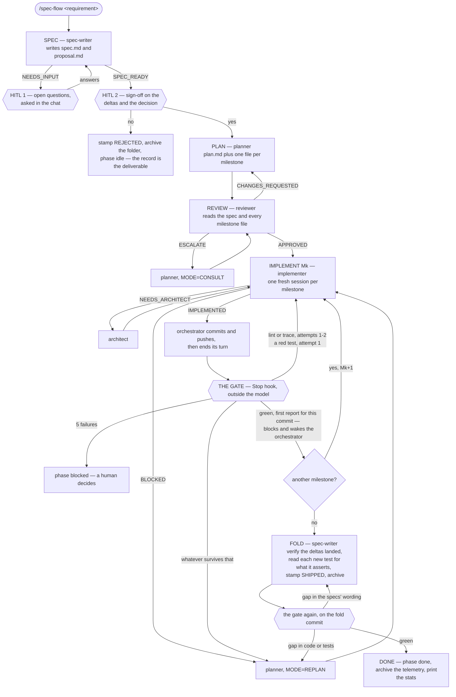
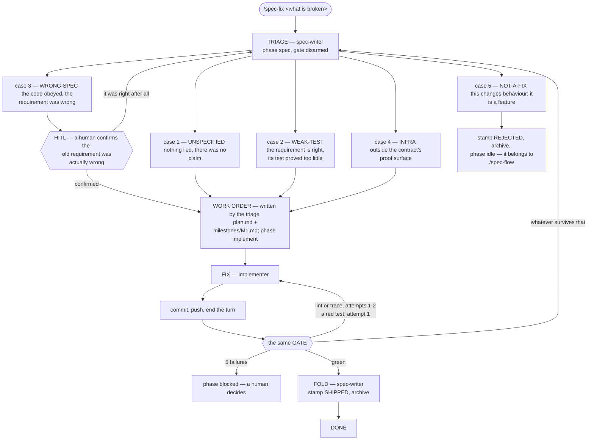
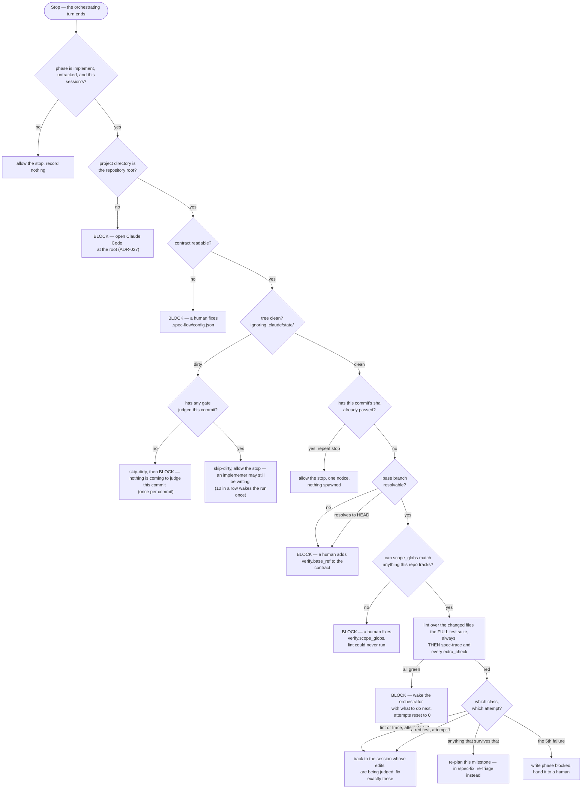

# Reference

Look-up material. For what spec-flow is and how to install it, see the
[README](README.md). The reasoning behind each rule is in
[`decisions/`](decisions/README.md).

- [The contract](#the-contract) — every field of `.spec-flow/config.json`
- [Four rules the contract cannot express](#four-rules-the-contract-cannot-express)
- [The base branch](#the-base-branch)
- [The second config file](#the-second-config-file)
- [Staying current](#staying-current)
- [Project skills](#project-skills)
- [Commands and agents](#commands-and-agents)
- [CLI](#cli)
- [Hooks](#hooks)
- [The live view](#the-live-view)
- [Phases](#phases)
- [`.claude/state/`](#claudestate)
- [What an install costs](#what-an-install-costs)
- [How a run unfolds](#how-a-run-unfolds) — the three flowcharts

---

## The contract

Everything the engine knows about your repo, at `.spec-flow/config.json` in
the repository root. Missing or malformed stops the run with a message naming
what to add; nothing guesses a runner or a directory. `spec-flow init`
generates it and reports what it could not determine. Opened at a subdirectory
of the repository, or at a directory in no repository — a workspace holding
several — `init`, `preflight`, the gate (`fail:root` in its history) and
`spec-flow check` refuse, and `phase-guard` refuses the phase write that would
start a run: git spells committed changes from the root, so from a subdirectory every
one would fall out of scope
([ADR-027](decisions/027-the-unit-of-a-run-is-the-repository.md),
[ADR-028](decisions/028-a-run-that-cannot-run-here-does-not-start.md)). To see
the contract as the engine reads it:

```bash
node <plugin-or-clone>/scripts/spec-flow-config.mjs
```

### `verify`

| key | required | what it is |
|---|---|---|
| `scope_globs` | yes | Which files count as in scope, e.g. `["*.ts"]`. **git pathspecs**: `*` already crosses `/`, so `"*.ts"` covers every depth. `**` is refused — `"**/*.ts"` would drop the repo root |
| `lint` | yes | argv that lints, autofix on. Changed file paths are appended |
| `lint_no_fix` | yes | Same, report only (`spec-flow check --no-fix`) |
| `test` | yes | argv that runs the whole suite, with **no** extra arguments |
| `test_name` | yes | Names the runner in log sections, e.g. `"vitest"` |
| `lint_name` | yes | Names the linter in log sections |
| `lint_config_hint` | yes | Where your lint rules live, quoted back when a rule fires |
| `base_ref` | no | The ref this branch is judged against. Omit to auto-resolve |

A pattern that matches nothing the repo tracks blocks the gate as `fail:scope`,
since lint could then never run.

### `trace`

| key | required | what it is |
|---|---|---|
| `specs_dir` | no | Where capability specs live. Default `specs` |
| `report` | no | `{format, path}` of the report your suite writes; `format` is `junit` or `tap` |
| `executed_tests` | no | argv printing the tests that RAN, one per line. The alternative to `report` |
| `proof_dir` | yes | Where a new test goes, e.g. `test` — guidance for the agents, not what counts as proof |
| `proof_suffix` | yes | What a test file is called, e.g. `.test.ts` |
| `not_a_capability` | no | Files under `specs_dir` that are not specs. Default `["README.md", "glossary.md"]` |
| `require_skills_field` | no | Fail a live milestone with no `Skills:` field. Default `false` |

#### What makes a requirement proven

A requirement is proven when a test **that ran** reports a name containing its
id. Declare one source, not both.

- **`report`** (the default): add your runner's reporter flag to `verify.test`
  and name the file. The engine parses JUnit XML and TAP itself —
  `<skipped/>`, `# SKIP` and `# TODO` say a test did not count, whoever wrote
  the file ([ADR-005](decisions/005-a-report-format-is-not-a-runner.md)). `init`
  proposes the flag for the Node runners it knows
  ([ADR-007](decisions/007-the-supported-scope-is-node.md)). The gate and
  `spec-flow check` remove the previous report before each suite, so a suite
  that stops writing it is refused, never judged by the last run's file.
- **`executed_tests`** (the escape hatch, for a runner with no standard
  report): `spec-flow init --translator` scaffolds
  `.spec-flow/tests-that-ran.mjs` with one marked hole; it exits non-zero until
  filled and is never overwritten.

Rules either way:

- **Names carry the id.** `describe > REQ-USER-001_rejects` and
  `test_REQ_USER_001_rejects` both bind (`_` is read as `-`); `REQ-USER-0011`
  never reads as `REQ-USER-001`.
- **A test that did not run is not proof.** `it.skip`, `test.todo`,
  `describe.skip`, a `--grep` that leaves it out and a runtime `t.skip()` all
  end absent from the report.
- **The body is not checked.** A test with the id and no assertion passes the
  gate; the engine reads no source
  ([ADR-020](decisions/020-a-tagged-test-is-judged-not-measured.md)).
  `MODE=FOLD` reads each new requirement's test once per change and reports weak
  ones on its `GAPS:` line, without gating.
- **Nothing to prove, nothing checked.** With no source declared, or a report
  not written yet, `spec-trace` says so and passes — until a requirement
  exists, when an unreadable source is refused.
- **An empty `specs_dir` passes until the first `SHIPPED` change** that names a
  requirement; after that it fails, because the fold claimed its deltas landed
  there.

`spec-trace` separates a report never written, a report holding nothing, a
report whose every case was skipped, and a requirement with no test. Run
`spec-flow check`, which runs your suite first; `spec-flow trace` alone reads
whatever the last run left.

### Writing a capability spec

`init` writes these rules into `specs/README.md`:

```markdown
<!-- spec-scope: modules/user -->

# User

### REQ-USER-001 — the user can reset their password by email

The system sends a single-use link, valid for one hour.
```

- The id prefix comes from the filename: `specs/user-profile.md` declares
  `REQ-USER-PROFILE-`.
- Exactly three digits. Ids are permanent — never renumbered or reused.
- The scope marker is required. Requirements are `###` headings, id first.

### Declaring a delta

A change spec declares what it does to `specs/`. `ADDED` fails when the new id
has no test that ran; `REMOVED` fails when a test still reports an id no spec
declares. A claim that appears, disappears or changes is `REMOVED` + `ADDED` on
a new id. `CHANGED` is only for edits that move no proof, and names which
([ADR-009](decisions/009-a-changed-delta-says-which-kind-it-is.md)):

```markdown
- CHANGED REQ-USER-001 (wording)    — means what it meant; the text is clearer
- CHANGED REQ-USER-001 (correction) — was wrong; now matches behaviour that
                                      already exists and is already proven
```

`(correction)` is legal only in a `/spec-fix` brief (case 3).

### `extra_checks`

Your own checks, run at every gate and again at `done`.

| key | required | what it is |
|---|---|---|
| `name` | yes | Shown in gate output |
| `cmd` | yes | argv, e.g. `["node", "scripts/my-check.mjs"]` |
| `field` | yes | The key it writes in `gate-history.log` |
| `green` | no | Line printed when it passes |
| `hint` | no | Appended to the block message when it fails |
| `class` | no | `"lint/trace"` (route as an edit, default) or `"behaviour"` (route as a re-plan) |

A `cmd` naming a repo-local script that does not exist yet is skipped, not
failed.

### `unscoped_denied`

What is redirected when an agent runs the whole suite mid-milestone. A
consistency guard for context size, not a security boundary.

| key | what it is |
|---|---|
| `scripts` | Package scripts denied while implementing, e.g. `["test", "lint"]` |
| `tools` | Binaries denied directly, e.g. `["vitest", "eslint"]` |
| `scoped_allowed` | Scripts that stay allowed, e.g. `["check"]` |
| `scoped_alternative` | What to run instead, quoted in the denial |
| `scoped_examples` | Concrete allowed invocations, shown in the denial |

---

## Four rules the contract cannot express

- **Gitignore `.claude/state/`.** Tracked, the tree is never clean and the gate
  skips every run after the first. A *committed* `phase` reads as no phase at
  all, so a cloned repo cannot arm the engine
  ([ADR-017](decisions/017-a-repository-does-not-get-to-arm-this-engine.md)).
- **No `--passWithNoTests`** (or equivalent) in `verify.test`: it turns a run
  that matched nothing into a green one.
- **`verify.test` finishes inside 1800s.** A Stop hook that times out is
  cancelled, and a cancelled Stop hook allows the stop. The gate writes
  `result=running` first, so the next gate finds the survivor, records
  `fail:killed` and blocks once. Declare a smoke subset if your suite is slower
  ([ADR-008](decisions/008-the-suite-is-never-scoped-to-the-diff.md)).
- **Work on a branch off your base.** Scope is the diff against the base; work
  committed onto the base branch has an empty diff, so the gate blocks as
  `fail:base` rather than let lint sit out the run.

---

## The base branch

Resolved in order: `verify.base_ref`, `refs/remotes/origin/HEAD`, then
`origin/main`, `main`, `origin/master`, `master`, `origin/develop`, `develop`,
`origin/trunk`, `trunk`.

None resolves → `preflight` refuses the run, and the gate blocks one already
underway. Resolves to **HEAD itself** → only the gate blocks (a fresh feature
branch sits at its base until its first commit, so `preflight` cannot tell).
There is no fallback: comparing HEAD with itself is indistinguishable from
"nothing changed". Declare `base_ref` for a release branch, a fork, or a
shallow CI checkout. Both refusals write `fail:base`; `files=-` means the base
could not be named, `files=0` means it resolved to HEAD.

---

## The second config file

`.claude/spec-flow.config.json` — preferences, not facts about the repo:

```json
{ "max_opus_calls": 6, "max_architect_calls": 3, "agents": { "architect": "fable" } }
```

- **`max_opus_calls`** (default 6) caps planner calls per run, and
  **`max_architect_calls`** (default 3) caps architect calls, each by role,
  whatever tier it runs on. Past a cap the spawn is denied and the orchestrator
  summarises for a human. Counters: `.claude/state/opus_calls` and
  `.claude/state/architect_calls`
  ([ADR-038](decisions/038-the-architect-answers-the-implementer-and-a-re-plan-needs-a-wrong-plan.md)).
- **`agents`** re-routes an agent to a tier: `opus`, `sonnet`, `haiku` or
  `fable`. The architect advisor runs on Opus unless routed;
  `/spec-flow:models architect fable` moves it to Fable. A hook applies it to
  the spawn; an unknown agent or tier denies the
  spawn ([ADR-014](decisions/014-a-project-routes-tiers-not-versions.md)).
- **No `effort`**: the file routes a tier, not an effort. Four agents declare
  their own; the implementer takes the session's `effortLevel`
  ([ADR-015](decisions/015-effort-is-declared-where-the-role-is-emphatic.md),
  [ADR-026](decisions/026-anatomy-is-stated-not-learned-from-source.md)).
  `CLAUDE_CODE_EFFORT_LEVEL`, when set, overrides all of them, and
  `spec-flow models` says so.
- **A concrete model version** is session-wide, set in the project's
  `.claude/settings.json` as `{"env": {"ANTHROPIC_DEFAULT_OPUS_MODEL": "<id>"}}`
  ([ADR-013](decisions/013-an-agent-names-a-tier-not-a-version.md)).

`spec-flow models` prints what each agent will run on and which layer decided
it, through the same code the spawn hook uses. None of this resets between
conversations; only `/model` and session-only effort do.

---

## Versions

- **Node** — a floor, enforced: `preflight` refuses a run below
  `package.json`'s `engines.node`, inside a run only.
- **Claude Code** — recorded, not checked: `cc=` on every gate-history line
  ([ADR-004](decisions/004-versions-checked-versus-recorded.md)), read from the
  session's transcript ([ADR-041](decisions/041-claude-code-is-read-from-the-transcript.md)).
- **The engine** — `engine=` on the same line: the commit of the copy that
  judged, or `v<version>` when no commit resolves
  ([ADR-018](decisions/018-the-engine-records-a-revision-not-a-version.md)).

## Staying current

Neither `plugin.json` nor the marketplace entry declares a `version`, so Claude
Code falls through to the git SHA and every push to `main` is an update
([ADR-003](decisions/003-no-plugin-version-field.md)). Take it with
`claude plugin update spec-flow@spec-flow-marketplace`, or `/plugin` →
**Installed** → **Update now**; a session keeps what it loaded until
`/reload-plugins` or the next launch. `claude plugin marketplace update` without
a name refreshes the listing and leaves the installed plugin where it is.

Background auto-update is off by default for third-party marketplaces. Once on,
it runs once per interactive session, within ten minutes of the first message,
and the session then says to `/reload-plugins`. `DISABLE_AUTOUPDATER`,
`DISABLE_UPDATES` or `CLAUDE_CODE_DISABLE_NONESSENTIAL_TRAFFIC` turns it off
unless `FORCE_AUTOUPDATE_PLUGINS=1`. Turn it on per install under `/plugin` →
**Marketplaces**, or for a repo in its `.claude/settings.json`:

```json
{
  "extraKnownMarketplaces": {
    "spec-flow-marketplace": {
      "source": { "source": "github", "repo": "IgnacioMarin402/spec-flow-plugin" },
      "autoUpdate": true
    }
  }
}
```

That entry wins over the per-install toggle, needs this folder trusted (not a
parent), registers the marketplace without installing the plugin, and is
replaced whole by a higher-precedence file defining the same name. A headless
`claude -p` session never uses it.

The optional devDependency does not follow: it is a git spec and moves when you
move it. Nothing detects the two halves on different commits
([ADR-016](decisions/016-one-repository-one-distribution.md)).

---

## Project skills

Claude Code already lists every skill's name and description to the agents, and
this plugin adds no index. The agents ship with no `skills:` frontmatter — which
skills exist is your codebase's business — and `planner` and `implementer`
carry the `Skill` tool.

The routing happens at plan time: each `milestones/Mk.md` has a `Skills:` field
the planner fills (`none` when nothing applies), and the implementer loads what
it names **before its first edit**. The reviewer checks the field;
`spec-trace` fails a missing one only with `trace.require_skills_field: true`,
which cannot be inferred because skills also arrive from plugins and from
`~/.claude/skills/`.

To preload instead, add your own `.claude/agents/implementer.md` with a
`skills:` line: a project agent outranks a plugin's.

**Write one skill that says how a module is built here** — its layers, the
kinds of file each has, how each is named, what a test is called — and keep it
under a page. The planner loads it before it opens any code and names it in
every milestone that adds a file, so the implementer loads it before its first
edit. Without it each agent learns the same thing from the source, in every
run, in its own cold context: on the run that prompted this, a planner with no
such statement read 25 files of two modules the change did not touch.
`spec-flow stats` reports each phase's reads outside the change's scope, which
is how you tell the statement is missing or incomplete
([ADR-026](decisions/026-anatomy-is-stated-not-learned-from-source.md)). A
short statement fits in `CLAUDE.md` instead, which every agent already
carries. Few skills with short descriptions beat many: every skill's name and
description is listed in every turn of the agents that carry the `Skill` tool.

---

## Commands and agents

| | |
|---|---|
| `/spec-flow <requirement>` | Full pipeline: spec, plan, review, implement, fold |
| `/spec-fix <what's broken>` | Defect flow: triage, one implementer pass, same gate |
| `/spec-flow:models` | Which tier each agent runs on and who decided. `<agent> <tier>` sets one, `<agent> default` clears it |
| `/spec-flow:resume [<SLUG>]` | Picks up a run a dead session left, at the step the disk says it reached ([ADR-024](decisions/024-a-run-resumes-from-what-is-on-disk.md)) |
| agents | `spec-writer`, `planner`, `reviewer`, `implementer`, `architect` — each one's tier and effort are in its own frontmatter; `spec-flow models` prints them |

---

## CLI

| command | what it does |
|---|---|
| `spec-flow init` | Generate `.spec-flow/config.json` and scaffold. `--force` to overwrite |
| `spec-flow check` | Lint changed files + full suite + unscoped checks. `--no-fix` to report only |
| `spec-flow trace` | `spec-trace` alone |
| `spec-flow stats` | Report over live and archived telemetry. `--raw` dumps the timeline |
| `spec-flow status` | Where the live run is, what the gate last said, what it has cost |
| `spec-flow resume [<SLUG>]` | The step an unfinished run resumes at, and the evidence for it |
| `spec-flow models` | Which tier each agent runs on here, and which layer decided it |
| `spec-flow telemetry --mark` | Record the telemetry offset at the start of a run |
| `spec-flow telemetry <SLUG>` | Archive this run's slice into the change folder |

**Inside a session none of this is needed**: every hook, command and agent
resolves through `${CLAUDE_PLUGIN_ROOT}`. The CLI is for a terminal without
Claude Code and for CI.

The short `spec-flow` name exists once the optional devDependency is installed:
`npm install --save-dev github:IgnacioMarin402/spec-flow-plugin#<commit-or-tag>`.
Nothing is published to npm, and `spec-flow` on npm is an unrelated package.
Without it, run the same scripts by path, from your repo's root:

| `spec-flow …` | by path |
|---|---|
| `init` | `node <clone>/scripts/init.mjs` |
| `check` | `node <clone>/scripts/check-changed.mjs` |
| `trace` | `node <clone>/scripts/spec-trace.mjs` |
| `stats` | `node <clone>/scripts/specflow-stats.mjs` |
| `resume` | `node <clone>/scripts/resume.mjs` |
| `telemetry` | `node <clone>/scripts/telemetry-snapshot.mjs` |

`<clone>` can be the installed plugin's own directory — the copy the gate runs.

---

## Hooks

| hook | event | fires on | what it does |
|---|---|---|---|
| `session-start` | `SessionStart` | — | Resets a run phase untouched for 6h+ to `idle` |
| `human-turn` | `UserPromptSubmit`, `Stop`, `PostToolUse` | `AskUserQuestion` (`PostToolUse`) | Records when the session's turn ends and when a person answers — never what they said — for the case 3 check ([ADR-036](decisions/036-a-case-3-waits-for-a-persons-answer.md)). Enforces nothing |
| `preflight` | `PreToolUse` | `Task`, `Agent`, `SendMessage` | Refuses a run whose project directory is not the repository root, whose contract does not load, whose base does not resolve, that has a live change folder the base already has, or whose Node is below the floor |
| `no-gate-cmds` | `PreToolUse` | `Bash` | Denies whole-repo lint/test runs while implementing |
| `phase-guard` | `PreToolUse` | `Bash`, `Write`, `Edit` | Denies a phase outside the closed set, an unearned `done` or `idle`, a `blocked` the gate did not write, the phase write that would start a run where the engine cannot run, and leaving `spec` while a live spec is not ready to build from, or a case 3 brief has no person's answer since it was written |
| `orchestrator-scope` | `PreToolUse` | `Read`, `Write`, `Edit`, `MultiEdit`, `NotebookEdit`, `Bash` | During a run, denies the session itself — not a subagent — reading a repository file outside `specflow/`, `specs/`, `.spec-flow/`, `.claude/` and the root's `*.md`, or writing, moving or deleting one outside `.claude/state/` and `specflow/`, or a log under `.claude/state/` ([ADR-034](decisions/034-the-orchestrator-routes-and-a-hook-keeps-it-routing.md)) |
| `opus-budget` | `PreToolUse` | `Task`, `Agent`, `SendMessage` | Counts planner and architect calls, each against its own cap, and denies past it |
| `arm-gate` | `PreToolUse` | `Task`, `Agent`, `SendMessage` | Writes `implement` when the implementer is engaged without it, by type, name or a message to its id; from `spec`, denies the spawn instead while a live spec is not ready to build from; in any run phase, denies it while a case 3 brief has no person's answer since it was written; on `done` or `idle`, denies this flow's implementer, which works only inside a run ([ADR-044](decisions/044-the-implementer-works-only-inside-a-run.md)) |
| `dispatch-guard` | `PreToolUse` | `Task`, `Agent`, `SendMessage` | Records, and lets through, a dispatch of the session's the commands do not describe: an agent outside its phase, one that is not this flow's, an implementer handed more or less than `plan.md` and its milestone, a message to an agent this session did not spawn ([ADR-035](decisions/035-a-dispatch-is-recorded-before-it-is-denied.md)); outside a run, this flow's agent put to work at all ([ADR-040](decisions/040-a-flow-agent-put-to-work-outside-a-run-is-recorded.md)) |
| `model-route` | `PreToolUse` | `Task`, `Agent` | Runs every spawn of this plugin in the background (interactive sessions), and applies the project's `agents` routing to it |
| `stale-resume` | `PreToolUse` | `SendMessage` | Denies resuming one of this plugin's agents whose prompt cache has expired ([ADR-025](decisions/025-an-agent-is-resumed-only-while-its-cache-is-warm.md)) |
| `lint-on-write` | `PostToolUse` | `Write`, `Edit` | Lints the file just written |
| `register-agent` | `PostToolUse` | `Task`, `Agent` | Maps session ids to agent types, so a `SendMessage` can be charged |
| `run-trace` | `PostToolUse`, `PostToolUseFailure`, `SubagentStop` | `Write`, `Edit`, `Read`, `Bash` (a failure: `Bash`) | The run's timeline, and each subagent's return. Enforces nothing |
| `agent-gate` | `SubagentStop` | — | Sends back, at most twice per agent, a return the orchestrator cannot route — no `STATUS:` where a return is owed, a status the agent's contract does not declare, a `*_PATH` to nothing — and a spec-writer's that breaks [ADR-030](decisions/030-a-spec-states-what-it-assumed-and-asks-at-most-three.md) ([ADR-031](decisions/031-an-agents-return-is-checked-before-it-is-acted-on.md)) |
| `token-trace` | `Stop` | — | Token accounting from the session's and its subagents' transcripts, an advisor's consultations apart, charged to whoever consulted it. Enforces nothing |
| `gate` | `Stop` | — | The external gate. The only hook that fails closed |

`gate`, `lint-on-write` and `no-gate-cmds` arm only on `implement`.
`preflight`, `opus-budget`, `stale-resume`, `phase-guard`, `orchestrator-scope` and `agent-gate` stand down
outside a run; `dispatch-guard` records only this flow's agents there, and `arm-gate` denies only its implementer. `model-route` applies to every spawn of this plugin's agents. Every hook but the gate
fails open on its own crash.

What the agent gate can see is a return's shape, the files on disk, the ids in
`specs/`, and which files the agent opened with Read. It cannot see an
ambiguity the spec-writer resolved without asking and did not list, a delta no
test could prove, or a contradiction with `specs/` nobody declared. Those stay
with the human at sign-off and with the reviewer.

---

## The live view

A mod in the same `hooks.json`
([ADR-037](decisions/037-a-mod-may-show-the-sessions-events-and-still-decides-nothing.md)).
It shows a pane with one box per spec-flow agent while the agent works: model,
effort, time, requests, how many tools and skills it called, the advisor's
consultations and their time, its tokens split into cache read, fresh and
output, and the last tool. When the agent finishes, its box shows the
`STATUS:` it handed back. The orchestrator, the phase and the last gate sit
above the boxes, the run line totals them with what the session cost as
`/cost` counts it, and the status line names the phase and who is running.

- `/spec-flow-live` opens the pane, even mid-turn. The pane also opens by
  itself at the first spawn, if there is room beside the transcript.
- It shows this session's run only: a phase another session owns, or one git
  tracks, shows as none.
- It gates nothing. The numbers `status`, `stats` and the snapshot report are
  `token-trace`'s, the advisor's tokens among them: Claude Code's events do
  not carry those, so the pane counts consultations only.
- The plugin's `live_view` setting turns it off. A Claude Code without
  function hooks skips it, and the engine runs as before.

---

## Phases

`.claude/state/phase` is the spine: every hook reads it to decide whether it is
armed.

| phase | written by | arms |
|---|---|---|
| `spec`, `plan`, `review` | orchestrator | `preflight`, Opus budget, `phase-guard`, `arm-gate`, `dispatch-guard` |
| `implement` | orchestrator, or `arm-gate` if it forgot | **the gate**, **lint-on-write**, **the command deny**, plus the above |
| `blocked` | **the gate**, at the attempt cap | `preflight`, Opus budget, `phase-guard`, `arm-gate`, `dispatch-guard` |
| `done` | orchestrator, if `phase-guard` allows | `dispatch-guard`, for this flow's agents only; `arm-gate`, denying its implementer |
| `idle` | orchestrator on rejection; `session-start` on an abandoned run | `dispatch-guard`, for this flow's agents only; `arm-gate`, denying its implementer |

- **The vocabulary is closed.** Any other value would disarm every hook at
  once, so `phase-guard` denies it.
- **The turn that writes `done` is the run's last**
  ([ADR-043](decisions/043-the-turn-that-writes-done-is-the-runs-last.md)):
  `run-trace` records the call that wrote it, and `token-trace` charges that
  turn.
- **A run that cannot run here does not start**
  ([ADR-028](decisions/028-a-run-that-cannot-run-here-does-not-start.md)). The
  first run phase written while no run is in progress is denied unless the
  directory is a repository root, the contract loads, the base resolves and no
  live change folder is one the base already has
  ([ADR-032](decisions/032-a-change-the-base-already-has-is-not-this-runs.md));
  nothing is armed by a refused start.
- **A phase write leaving `spec` needs a spec its first gate would accept**
  ([ADR-030](decisions/030-a-spec-states-what-it-assumed-and-asks-at-most-three.md)).
  `plan`, `review` or `implement` written from `spec` is denied while a live
  spec with no plan yet has no `## Assumptions` (a `/spec-fix` brief needs
  none) or fails a check spec-trace makes of live changes. `arm-gate` holds
  the implementer spawn that would leave `spec` to the same check
  ([ADR-035](decisions/035-a-dispatch-is-recorded-before-it-is-denied.md)).
- **A case 3 waits for a person's answer**
  ([ADR-036](decisions/036-a-case-3-waits-for-a-persons-answer.md)). While a
  live fix brief carries a `CHANGED … (correction)` delta that no person has
  answered since its last write — a prompt typed after the session's turn
  ended, or an answered question — leaving `spec` and engaging the implementer
  are denied. It stands down, and says so in `human-turn-unmatched.log`, where
  no answer was ever recorded.
- **A run does not end itself without a verdict**
  ([ADR-022](decisions/022-a-run-does-not-end-itself-without-a-verdict.md)).
  `done` needs every unscoped check green, no unarchived `specflow/<SLUG>/`,
  and a gate pass on the current commit. `idle` is denied from `implement`, and
  from `spec`/`plan`/`review` until the change is stamped and archived; from
  `blocked` it is allowed. `blocked` is written only by the gate.
- **A phase belongs to one session.** `phase-guard` records the writer in
  `.claude/state/phase.session`; the gate and the Opus budget ignore a phase
  sealed by another session. Both checks fail closed
  ([ADR-017](decisions/017-a-repository-does-not-get-to-arm-this-engine.md)).
- **To stand a run down yourself**: `printf 'idle' > .claude/state/phase`.
- **Without a terminal** (`claude -p`, the Agent SDK, CI) a run needs
  `--permission-mode auto` or `bypassPermissions`. `.claude/` is a protected
  path: in `default` and `acceptEdits` the phase write asks a human who is not
  there, no allow rule pre-approves it, and the run never starts.

---

## `.claude/state/`

Gitignored working files; delete one to reset that piece of state.

| file | what it holds |
|---|---|
| `phase` / `phase.session` | The current phase, and the session that owns it |
| `gate_attempts` | Consecutive gate failures. Reset on pass, capped at 5 |
| `current-milestone` | `<SLUG> <Mk> <implementer session>`, written at each implementer spawn; where `resume` positions the run |
| `opus_calls` / `architect_calls` | Planner calls / architect calls this run |
| `gate-history.log` | One line per gate invocation; a surviving `running` line means that invocation was killed |
| `gate-failure.log` / `.full.log` | Last failure, truncated for the planner / whole for a human |
| `run-trace.log` | Reads, writes, test verdicts, subagent outcomes, agent-gate checks, token counts, the write that closed the run |
| `run-offset` / `token-offset` | Where this run's telemetry starts / how far the token accounting has read |
| `agent-registry` | Session id → agent type |
| `model-routes.log` | One line per re-routed agent |
| `human-turn.log` | One line per turn end, prompt (by source) or answered question — never what was said. The case 3 check reads it |
| `*-unmatched.log` | What each hook could not read — how a hook that fails open reports its blind spots |

---

## What an install costs

`claude plugin details spec-flow` prints what the plugin adds to every session
and what each agent and command costs when invoked. The hooks cost no model
context — the checks run outside the model.

---

## How a run unfolds

Nothing coordinates a run but `.claude/state/phase`. A subagent finishes, the
orchestrator's turn ends, and the `Stop` hook runs the checks outside the model
and either allows the stop or blocks with the next instruction. The
orchestrator never writes code; the gate's block message *is* the next step.

### `/spec-flow` — a feature



A milestone gets a **fresh** implementer session; every retry within it goes
back to the *same* session, because re-reading from a cold context is where
most of a run's tokens go.

### `/spec-fix` — a defect

A defect is a closed question — which side is wrong, the code or its
requirement — so this flow triages instead of planning, and drops the planner
and the reviewer.



Only cases 3 and 5 stop for a human: a diff cannot tell a requirement rewritten
to match the code from one rewritten to match the bug.

### The gate



- **Nothing is judged while a subagent is still running** — the stop ends a
  turn, not a milestone ([ADR-023](decisions/023-every-spawn-runs-in-the-background.md)).
- **A dirty tree is not judged** — a background implementer may be mid-write —
  but it wakes the run once on a commit no gate has judged, and after ten
  dirty stops in a row ([ADR-012](decisions/012-a-dirty-tree-on-an-unjudged-commit-wakes-the-run.md)).
- **spec-trace runs after the suite**, so it judges this run's report.
- **Lint is scoped to the changed files; the suite never is**, not even on an
  empty scope ([ADR-008](decisions/008-the-suite-is-never-scoped-to-the-diff.md)).
- **A pass blocks once per commit**, not once per stop
  ([ADR-010](decisions/010-a-green-gate-wakes-the-run.md)).
- **The failure class decides the route**: a traceability gap is usually a test
  that never named its requirement — an edit, not a re-plan.
- **It fails closed**: an unhandled throw blocks, because a Stop hook that
  prints nothing allows the stop.
